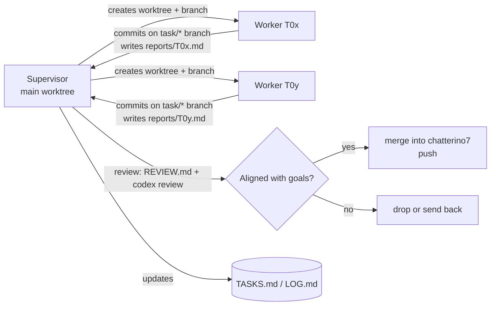

# Agent coordination

This directory lets a supervisor agent and several worker agents keep working
on chatterino7-yt across sessions and context resets. Everything an agent
needs to pick up where the last one stopped is in here.

## Files

| File | Who writes it | Purpose |
| --- | --- | --- |
| [`TASKS.md`](TASKS.md) | supervisor | Task board: status, branch, owner, scope |
| [`LOG.md`](LOG.md) | supervisor | Short dated log of what happened and why |
| [`REVIEW.md`](REVIEW.md) | supervisor | Merge checklist |
| `reports/T##.md` | worker | What the worker did, how it was verified, open questions |

Goals and scope: [`docs/fork/ROADMAP.md`](../docs/fork/ROADMAP.md).
Network policy: [`docs/fork/NETWORK.md`](../docs/fork/NETWORK.md).

## Product north star

A clean, boring client for **chatters and moderators on Twitch and YouTube**.
The important emotes (7TV, BTTV, FFZ) and solid mod tools; nothing cutting
edge. Privacy first, official APIs only, verifiable builds.

When in doubt, prefer: fewer lines, less surface area, better tests and
tooling, smaller diff against upstream.

## Layout on disk

- Main worktree (supervisor only): `~/.t3/projects/chatterino7-yt`, branch `chatterino7`
- Worker worktrees: `~/.t3/projects/c7yt-wt/T##`, branch `task/T##-<slug>`
- Build: `scripts/dev/docker-build.sh {app|test|check|asan}`. All checkouts
  share one ccache (`~/.cache/c7yt-ccache`). Set `C7YT_JOBS=4` when more than
  one build might run at once.

## Supervisor loop

On every check-in (timer, finished worker, or a fresh context):

1. Read `TASKS.md` and the tail of `LOG.md`.
2. For each worker that finished: read `reports/T##.md`, review the branch
   against `REVIEW.md` (`git diff chatterino7...task/T##-*`), and run
   `codex exec review` on it for a second opinion.
3. Merge only what clearly fits the north star (`git merge --no-ff`). Run
   `scripts/dev/docker-build.sh check` on the result if C++ changed, then
   push `chatterino7`. Otherwise send it back with notes or drop it, and log
   why.
4. Remove finished worktrees (`git worktree remove`).
5. Start new workers for `todo` tasks whose dependencies are merged. At most
   3 workers at once, at most 2 of them doing C++ builds.
6. Add quality tasks you notice (tooling, tests, linting, docs clarity,
   turning off risky features). Don't add features beyond the roadmap.
7. Update `TASKS.md` and append to `LOG.md`.

## Worker rules

- Work only in your own worktree and branch. Never touch the main worktree,
  except for writing `.agents/reports/T##.md` there (absolute path).
- Don't push, don't open PRs, don't edit `.agents/TASKS.md`.
- Keep the diff small. New code goes in new files and directories; edits to
  upstream files are small hooks with a `chatterino7-yt:` comment when the
  reason isn't obvious.
- Verify before you report: build and test where C++ changed; run
  `zizmor .github/workflows` when workflows changed; run
  `scripts/fork/check-network-hosts.py` when URLs changed.
- Commit with conventional-commit messages (`feat:`, `fix:`, `ci:`, `docs:`,
  `test:`, `chore:`) and end each message with a
  `Co-Authored-By: Claude Opus 5.5 <noreply@anthropic.com>` trailer.
- The report covers: summary, files changed, how it was verified (commands +
  results), anything you decided not to do and why, open questions.
