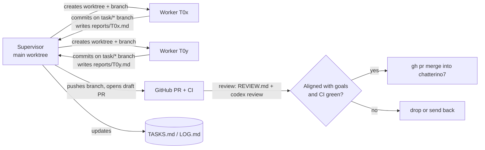

# Agent coordination

> Overnight ownership and live state: read [NIGHT.md](NIGHT.md) first.
> The old Claude supervisor is retired; workers use assigned isolated checkouts.

This directory lets a supervisor agent and several worker agents keep working
on chatterino7-yt across sessions and context resets. Everything an agent
needs to pick up where the last one stopped is in here.

## Files

| File                     | Who writes it | Purpose                                                  |
| ------------------------ | ------------- | -------------------------------------------------------- |
| [`TASKS.md`](TASKS.md)   | supervisor    | Task board: status, branch, owner, scope                 |
| [`LOG.md`](LOG.md)       | supervisor    | Short dated log of what happened and why                 |
| [`REVIEW.md`](REVIEW.md) | supervisor    | Merge checklist                                          |
| `reports/T##.md`         | worker        | What the worker did, how it was verified, open questions |

Goals and scope: [`docs/fork/ROADMAP.md`](../docs/fork/ROADMAP.md).
Network policy: [`docs/fork/NETWORK.md`](../docs/fork/NETWORK.md).

## Product north star

A clean, boring client for **chatters and moderators on Twitch and YouTube**.
The important emotes (7TV, BTTV, FFZ) and solid mod tools; nothing cutting
edge. Privacy first, official APIs only, verifiable builds.

When in doubt, prefer: fewer lines, less surface area, better tests and
tooling, smaller diff against upstream.

## Layout on disk

- Main worktree (supervisor only): `~/.t3/projects/chatterino7-yt`, branch `chatterino7`
- Worker worktrees: `~/.t3/projects/c7yt-wt/T##`, branch `task/T##-<slug>`
- Build: `scripts/dev/docker-build.sh {app|test|check|asan}`. All checkouts
  share one ccache (`~/.cache/c7yt-ccache`). Set `C7YT_JOBS=4` when more than
  one build might run at once.

## Supervisor loop

Only the overnight controller’s designated supervisor may integrate changes until
08:00 Europe/Berlin on 2026-10-12. Other sessions yield that role and use assigned
worker checkouts. Read NIGHT.md before resuming any previous session.

> **Heavy CI is paused at the user's request (2026-10-12).** Disabled with
> `gh workflow disable` (no file changes): Build, Build FreeBSD, Test
> Ubuntu/Arch/MacOS/Windows, clang-tidy (+ review poster), Create installer,
> Publish to WinGet. Still running: Lint, Check formatting, zizmor, Network
> host gate, CodeQL, Scorecard, REUSE, EventSub python test. Until it's
> re-enabled, the local `scripts/dev/docker-build.sh check` is the merge gate
> for C++ changes. Re-enable with `gh workflow enable <file>` before the first
> release (task T13).

All progress is visible on GitHub (pjeweb/chatterino7-yt): every task is a PR.

On every check-in (timer, finished worker, or a fresh context):

1. Read `TASKS.md` and the tail of `LOG.md`.
2. Push every task branch that has new commits
   (`git push -u origin task/T##-*`) and make sure it has a **draft PR**
   against `chatterino7` titled `T##: <title>`, with a body linking to the
   task spec. Link each new PR to this thread (`link_pull_request`).
3. For each worker that finished: read `reports/T##.md` (put its summary in
   the PR body), review the diff against `REVIEW.md`, and get a second
   opinion with `cd ~/.t3/projects/c7yt-wt/T## && codex exec review --base chatterino7`
   (`--base`/`--commit` can't be combined with a custom prompt). Post the
   review outcome as a PR comment.
4. Merge only what clearly fits the north star. Run
   `scripts/dev/docker-build.sh check` locally if C++ changed, mark the PR
   ready, wait for CI to go green, then `gh pr merge --merge --delete-branch`
   and `git pull` in the main worktree. Otherwise request changes (comment +
   send the worker back) or close the PR, and log why.
5. Remove finished worktrees (`git worktree remove`).
6. Start new workers for `todo` tasks whose dependencies are merged. At most
   3 workers at once, at most 2 of them doing C++ builds.
7. Add quality tasks you notice (tooling, tests, linting, docs clarity,
   turning off risky features). Don't add features beyond the roadmap.
8. Update `TASKS.md` and append to `LOG.md`, commit and push `chatterino7`.

## Worker rules

- Work only in your assigned worktree and branch. Reports are committed in your
  own `.agents/reports/`; never write the main worktree or shared task board.
- Don't push, don't open PRs, don't edit `.agents/TASKS.md`.
- Keep the diff small. New code goes in new files and directories; edits to
  upstream files are small hooks with a `chatterino7-yt:` comment when the
  reason isn't obvious.
- Verify before you report: build and test where C++ changed; run
  `zizmor .github/workflows` when workflows changed; run
  `scripts/fork/check-network-hosts.py` when URLs changed; run
  `npx prettier@3.8.1 --write <files>` on changed Markdown/YAML (CI's Lint job
  fails otherwise).
- Commit with conventional messages (`feat:`, `fix:`, `ci:`, `docs:`, `test:`,
  `chore:`). Use truthful attribution; never add another provider’s coauthor.
- The report covers: summary, files changed, how it was verified (commands +
  results), anything you decided not to do and why, open questions.
