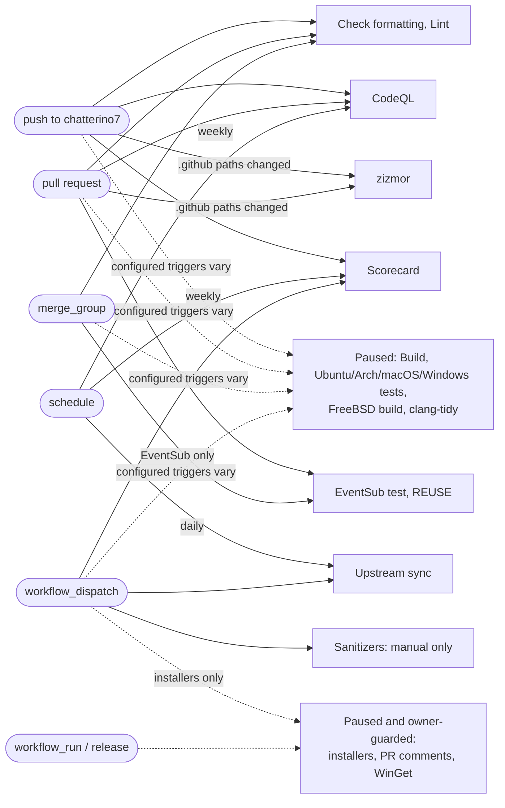

# CI

Fork workflows are `fork-*.yml`; upstream changes stay small. The diagram shows
configured triggers for `chatterino7` pushes, PRs, schedules and merge queues.
**As of 2026-10-12, heavy build/test workflows and upstream publishing workflows
are manually disabled on pjeweb/chatterino7-yt.** A PR or manual dispatch does
not bypass that pause. This audit does not enable them.

EventSub and FreeBSD also have push triggers for upstream branch names;
macOS/Windows tests and clang-tidy have no `chatterino7` push trigger. Exact
branch/event filters live in each workflow, including the paused ones.

| Workflow                                    | Check or output when enabled and successful                                              |
| ------------------------------------------- | ---------------------------------------------------------------------------------------- |
| Build (paused)                              | Linux AppImage/deb/Flatpak, Windows x64/ARM64, macOS universal build artifacts           |
| Ubuntu, Arch, macOS, Windows tests (paused) | Unit tests; Ubuntu also smoke-runs benchmarks                                            |
| FreeBSD (paused)                            | FreeBSD 14 build                                                                         |
| clang-tidy (paused)                         | Review diagnostics artifact/log; compile errors fail                                     |
| Check formatting                            | clang-format 19 and LF line endings                                                      |
| Lint                                        | Prettier, LuaLS metadata, theme schema                                                   |
| EventSub python test                        | Generator tests and committed generated sources                                          |
| REUSE                                       | Advisory licence report (`continue-on-error`)                                            |
| CodeQL                                      | C/C++ extraction without a build and Actions analysis, uploaded to code scanning         |
| zizmor                                      | Workflow security findings uploaded to code scanning                                     |
| Scorecard                                   | Supply-chain findings uploaded to code scanning and published to OpenSSF                 |
| Upstream sync                               | Merge PR, or an issue listing conflicts; no automatic merge                              |
| Sanitizers (manual only)                    | Local-container ASan/UBSan tests, instrumented implementation libraries, diagnostic logs |

zizmor's SARIF mode reports findings without failing the job; blocking findings
requires code-scanning merge protection. The upstream findings remain visible.
Upstream sync needs `SYNC_TOKEN` for workflow-file pushes and automatic PR CI;
`GITHUB_TOKEN` PR workflows require approval before running.

| Fork-disabled operation          | Guard                                                            |
| -------------------------------- | ---------------------------------------------------------------- |
| Build nightly release/tag        | `build.yml`: owner `SevenTV`                                     |
| Installer nightly/draft releases | `create-installer.yml`: owner `SevenTV`; dependent jobs skip too |
| clang-tidy PR comments           | `post-clang-tidy-review.yml`: owner `SevenTV`                    |
| WinGet publish                   | `winget.yml`: owner `Chatterino`                                 |
| Codecov upload                   | `test.yml`: owner `Chatterino`                                   |

New fork workflows start with `permissions: {}`, grant only documented per-job
permissions, pin actions to SHAs and use `persist-credentials: false`. Upstream
checks default to `contents: read`; publishing overrides remain owner-guarded.
Local `zizmor .github/workflows/fork-*.yml` must report no findings. Remaining
upstream findings are recorded in the [T01 audit report](../../.agents/reports/codex-T01.md).

`fork-sanitizers.yml` has only `workflow_dispatch` while heavy CI is paused;
PR/push triggers are deferred to T13. It builds the digest-pinned official
container from `scripts/dev/Dockerfile`, then runs the same
`C7YT_JOBS=4 scripts/dev/docker-build.sh asan` command used locally. This checks
both sanitizer flags in every application/EventSub library and test compile
command, runs with fatal ASan/UBSan diagnostics and leak detection, and does
not retry failed tests. ASan mode uses `RelWithDebInfo` at `-O1 -g`; Qt/release
assertions are disabled to avoid GCC 15's UBSan/constexpr pointer-check
[compiler issue](https://gcc.gnu.org/pipermail/gcc-patches/2025-July/688787.html).
Both sanitizers stay enabled. Ordinary `check` remains a Debug build.
Prebuilt Qt/system libraries are not instrumented.
