# Fork docs

| Doc                              | One line                                                               |
| -------------------------------- | ---------------------------------------------------------------------- |
| [ROADMAP.md](ROADMAP.md)         | Goals, principles, phased checklist (design vs landed)                 |
| [NETWORK.md](NETWORK.md)         | Host inventory, defaults, CI host gate                                 |
| [FEATURES.md](FEATURES.md)       | Risky-feature decisions and evidence                                   |
| [CI.md](CI.md)                   | Workflow triggers, pause status, owner guards                          |
| [youtube.md](youtube.md)         | **Design only** — official YouTube Data API v3 live chat               |
| [translation.md](translation.md) | **Design only** — on-device Bergamot first, optional BYO-key providers |

```mermaid
flowchart TB
  app[chatterino7-yt]
  subgraph req [Required — Twitch chat]
    twitchIRC["irc.chat.twitch.tv / EventSub / PubSub"]
    twitchAPI["api.twitch.tv / id.twitch.tv"]
    twitchCDN["static-cdn.jtvnw.net"]
  end
  subgraph emo [Emotes — on by default]
    stv["7tv.io + events.7tv.io"]
    bttv["api/cdn/sockets.betterttv.net"]
    ffz["api.frankerfacez.com"]
  end
  subgraph act [Optional activity — off by default]
    stvP["7TV presence"]
    bttvP["BTTV broadcastMe"]
    hist["recent-messages.robotty.de"]
    ivr["api.ivr.fi"]
  end
  subgraph prop [Proposed — not implemented]
    yt["YouTube Data API + OAuth + Atom"]
    tr["Translation: Bergamot / DeepL / LibreTranslate"]
    upd["Signed Sparkle / WinSparkle updater"]
  end
  app --> twitchIRC & twitchAPI & twitchCDN
  app --> stv & bttv & ffz
  app -.->|user opt-in| stvP & bttvP & hist & ivr
  app -.-> yt & tr & upd
```

Solid edges are in-tree behaviour. Dashed edges are opt-in activity or
unimplemented providers. Kick remains inherited and ungated; see NETWORK.md.
Updater checks are compiled out (`CHATTERINO_UPDATER=OFF`), not replaced.
